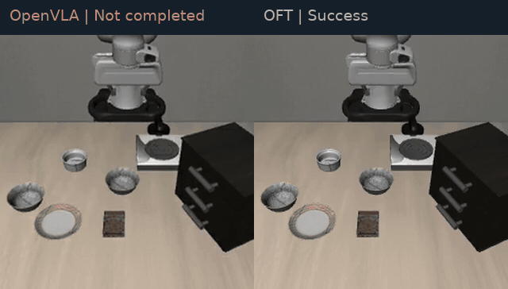
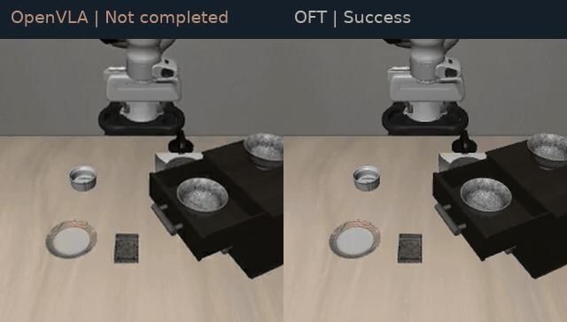

# VLA 参数高效微调与机械臂闭环评测

基于 OpenVLA / OpenVLA-OFT，完成从示教数据、参数高效微调到机械臂闭环评测的完整流程。在 **单张 RTX 5070 Ti 16GB** 上训练 7B 级 VLA，LIBERO-Spatial 成功率达到 **95.6%**，较本地 OpenVLA 基线提高 **11.0 个百分点**。

项目将模型训练与规划控制结合：向上追踪视觉、语言与动作学习，向下解析末端动作、OSC 控制器和物理引擎之间的执行链路。

## 操作效果

左侧为官方套件微调权重的 OpenVLA，右侧为本项目训练的 OFT。两组分别对应同一任务、同一 LIBERO 默认初始状态编号，按原日志帧率同步播放；任务结束的一侧保留末帧。

**桌面取放：从桌面中央拾取黑碗并放到盘中**



[播放 MP4](media/table-center.mp4) · Spatial 第 3 个任务，第 1 次试验

**抽屉取放：从木柜顶层抽屉取出黑碗并放到盘中**



[播放 MP4](media/top-drawer.mp4) · Spatial 第 5 个任务，第 3 次试验

展示案例选自 OpenVLA 未完成、OFT 完成的对应试验；整体表现见下方完整套件统计。素材来源和制作参数见 [media/README.md](media/README.md)。

## 闭环评测

在 LIBERO / robosuite / MuJoCo 中完成操作任务，每套件 **10 个任务 × 50 次试验**，保留逐次结果与逐任务统计。

| 模型与权重来源 | 套件 | 成功次数 | 成功率 |
| --- | --- | ---: | ---: |
| OpenVLA 官方套件微调权重 | Spatial | 423 / 500 | 84.6% |
| OpenVLA 官方套件微调权重 | Object | 433 / 500 | 86.6% |
| OpenVLA 官方套件微调权重 | Goal | 375 / 500 | 75.0% |
| **本项目训练的 OpenVLA-OFT** | **Spatial** | **478 / 500** | **95.6%** |


[逐任务统计](results/tasks.csv) · [逐次结果](results/episodes.csv) · [评测日志](results/evaluations)

## 单卡训练

从 `openvla/openvla-7b` 初始化，在 `libero_spatial_no_noops` 示教数据上进行任务微调。结合 **8-bit 主干加载、LoRA 和非重入梯度检查点**，将 7B 模型训练流程部署到单卡 16GB 环境。

| 配置 | 本项目 |
| --- | --- |
| 策略输入 | 外部视角 RGB + 语言指令 |
| 动作表示 | L1 连续动作头，8 步动作块，每步 7 维 |
| 参数更新 | LoRA rank 32 + 独立动作头 |
| 有效 batch | 1 × 16 次梯度累积 |
| 学习率 | `5e-4`，8,000 步后衰减至 `5e-5` |
| 训练步号 | 10,000 |
| 运行时长 | 约 38 小时 5 分钟 |
| 最终训练 L1 | 0.0908 |


保存 2,500 / 5,000 / 7,500 / 10,000 步 checkpoint，并从 W&B 离线记录导出 **1,001 个训练指标点**，串联训练过程、权重保存与闭环验收。

[训练配置](configs/oft_spatial.json) · [曲线数据](results/training/oft.csv) · [实验记录](docs/实验记录.md)

## 与官方 OFT 的关系

沿用官方 OFT 的并行动作解码、连续动作头和动作分块，在此基础上完成单卡训练适配与独立微调。

| 项目 | 官方 LIBERO 论文训练配方 | 本项目 |
| --- | --- | --- |
| 主干训练加载 | BF16 | 8-bit 量化 |
| 参数更新 | LoRA rank 32 + 动作头 | LoRA rank 32 + 动作头 |
| 策略输入 | 双相机 + 语言 + 机器人状态 | 单相机 + 语言 |
| 动作输出 | 8 × 7 连续动作块 | 8 × 7 连续动作块 |
| 训练规模 | 8 GPU，每卡 batch 8，约 150k 步 | 单卡 16GB，batch 1、累积 16，10k 步 |

[完整配方对照](docs/OFT配方对照.md)

## 动作生成范式对比

在同一个 OFT 基座、同一份示教数据、同一组超参数和同一套评测脚本下，对比 L1 回归、扩散和流匹配三种连续动作生成方式。流匹配沿用 π0 的 rectified flow 形式，训练时回归速度场，推理时用 10 步欧拉积分生成动作块。

| 范式 | 训练目标 | 推理步数 |
| --- | --- | ---: |
| L1 回归 | 直接回归动作 | 1 |
| 扩散 | 预测噪声 + DDIM 去噪 | 50 |
| 流匹配 | 预测速度场 + 欧拉积分 | 10 |

三组在同一基座、同一示教数据、同一超参数和同一评测设置下训练与评测，各 10k 步：

| 范式 | 推理步数 | 成功次数 | 成功率 | 训练耗时 | 最终动作 L1 |
| --- | ---: | ---: | ---: | ---: | ---: |
| L1 回归 | 1 | **478 / 500** | **95.6%** | 38.1 h | 0.0942 |
| 流匹配 | 10 | 385 / 500 | 77.0% | 43.6 h | 0.1504 |
| 扩散 | 50 | 282 / 500 | 56.4% | 51.7 h | 0.2567 |

流匹配的离线动作误差比扩散低 42%，训练耗时少 16%，但两种生成式方法都落后于直接回归。**三种方法在同一批观测上的首步动作 L1 几乎相同（0.177 / 0.182 / 0.231），闭环成功率却相差 39 个百分点** —— 单步数值误差不足以判断策略可用性。

训练全程记录裁剪前的梯度总范数，尖峰集中在最初 100 步后单调收敛，没有出现此前 QLoRA 实验中的中途退化。


三种范式共用同一套接口，切换只依靠命令行开关；配套的数学正确性测试覆盖插值、速度目标、时间采样、积分方向与收敛性，其中"给定精确速度场时欧拉积分能还原示教动作"这一项用于防止积分方向或符号写反。

[范式对比与实现说明](docs/动作生成范式对比.md) · [结果数据](results/paradigm/summary.json) · [适配补丁](patches/flow-matching.patch) · [正确性测试](tests/test_flow_matching.py)

训练过程记录由只读采集器完成：训练指标（损失、动作 L1、**裁剪前梯度范数**、学习率）每 10 步一个点，GPU 显存、利用率、功耗与温度每 5 分钟一条样本，另有每 30 分钟一份状态快照。采集与定时检查都不干预训练进程。

[监控脚本与指标说明](monitoring/README.md)

## 动作与控制

```text
RGB + 语言指令
      ↓
视觉编码器 → 特征投影 → 语言模型
      ↓
连续动作头 → 8 × 7 动作块 → 反归一化
      ↓
末端平移 / 旋转指令 + 夹爪动作
      ↓
OSC 控制器 → 关节力矩 → MuJoCo 步进
      ↓
新观测 → 下一轮策略预测
```

围绕动作坐标、归一化、执行频率和控制器目标更新，建立从策略输出到机器人执行的代码阅读路径，衔接规划控制与 VLA 策略学习。

[控制链路解析](docs/控制链路.md)

## 运行

安装依赖、准备模型和数据后，通过独立入口执行源码准备、训练与评测：

```bash
# 固定上游版本并应用本地补丁
VLA_WORKSPACE="$HOME/vla-work" bash scripts/prepare_sources.sh

# 单卡 OFT 微调
VLA_WORKSPACE="$HOME/vla-work" \
MODEL_PATH="$HOME/vla-models/openvla-7b-oft" \
DATA_ROOT="$HOME/vla-data" \
bash scripts/train_oft.sh

# LIBERO-Spatial 闭环评测
VLA_WORKSPACE="$HOME/vla-work" \
CHECKPOINT="$HOME/vla-runs/your-checkpoint" \
bash scripts/eval_oft.sh

# 校验已归档结果
python3 scripts/verify_results.py
```

[环境与复现步骤](docs/复现.md) · [源码版本](configs/versions.json) · [适配补丁](patches)

## 思考

机械臂操作需要把模型拟合、动作解释和任务完成串成闭环。训练曲线用于观察学习过程，逐任务评测用于定位场景差异，动作与控制器追踪则帮助判断问题发生在策略还是执行环节。

这也是规划控制背景能与 VLA 结合的切入点：既看模型预测了什么，也追踪动作经过控制器后如何影响机器人，再用闭环结果检验策略。

## 来源

- [OpenVLA](https://github.com/openvla/openvla)
- [OpenVLA-OFT](https://github.com/moojink/openvla-oft)
- [LIBERO](https://github.com/Lifelong-Robot-Learning/LIBERO)
- [OFT Transformers 分支](https://github.com/moojink/transformers-openvla-oft)

上游许可保留于 [LICENSES](LICENSES)，模型与数据沿用各自使用条款。
