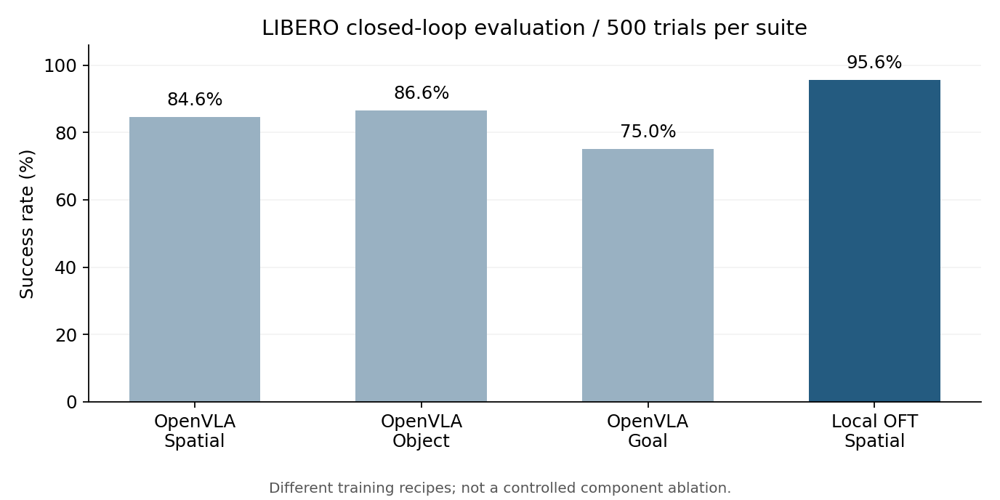
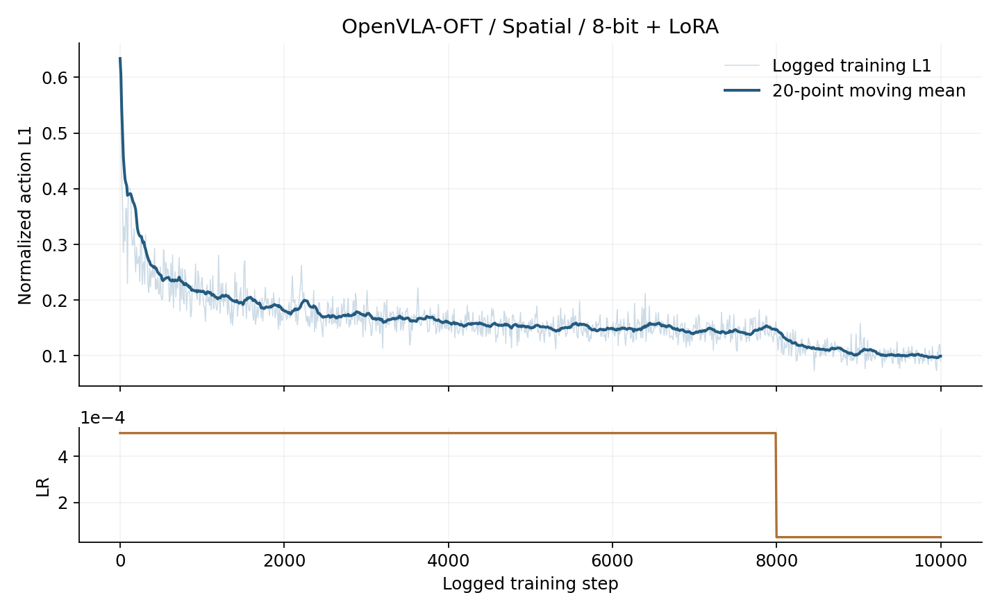

# VLA / OFT 机械臂操作实验

从自动驾驶规划与控制转向机器人操作的一组实验：先复现 OpenVLA 的闭环表现，再在单卡 16GB 显存上完成 OpenVLA-OFT 微调，追踪模型动作如何通过控制器驱动机械臂。

这里保留本地适配补丁、训练与评测入口、训练曲线和逐次评测记录。模型结构和训练方法来自上游项目；本仓库的工作集中在资源适配、实验核验与控制链路分析。

## 结果

| 模型与权重来源 | 套件 | 成功次数 | 成功率 |
| --- | --- | ---: | ---: |
| OpenVLA 官方套件微调权重 | Spatial | 423 / 500 | 84.6% |
| OpenVLA 官方套件微调权重 | Object | 433 / 500 | 86.6% |
| OpenVLA 官方套件微调权重 | Goal | 375 / 500 | 75.0% |
| 本地 OpenVLA-OFT 微调 | Spatial | 478 / 500 | **95.6%** |

每套件包含 10 个任务，每任务 50 次试验。以上为 LIBERO / robosuite / MuJoCo 仿真结果，没有真机实验。

OFT 相对本地 OpenVLA Spatial 基线高 **11.0 个百分点**。两者的动作表示、训练方式和模型执行路径不同，这个差值描述整套方案的结果，不代表某个单独改动带来的收益。当前只完成一次完整 OFT 训练与一次最终评测，没有多训练种子的方差估计。



## 训练

从 `openvla/openvla-7b` 初始化，在 `libero_spatial_no_noops` 示教数据上微调。采用 8-bit 主干加载、LoRA rank 32、非重入梯度检查点和 L1 连续动作头；输入单张外部视角图像及指令，输出 **8 × 7** 的动作块。

单张 RTX 5070 Ti 16GB，microbatch 为 1，梯度累积 16，学习率从 `5e-4` 在 8,000 步后降至 `5e-5`，训练至日志步号 10,000。W&B 记录运行约 **38 小时 5 分钟**，最终记录的训练 L1 为 **0.0908**。训练误差与仿真成功率分别衡量拟合和实际任务完成情况。



原版 OpenVLA 的 QLoRA 实验也保留在[实验记录](docs/实验记录.md)中。它出现了闭环零成功与动作趋同现象，原因仍未定论。没有把它解释为“离散动作不可行”，也没有把未完成的梯度裁剪对照写成结论。

## 怎么看

- [复现步骤](docs/复现.md)：上游版本、环境快照、补丁及运行命令。
- [实验记录](docs/实验记录.md)：各次实验、失败现象、结论的适用范围。
- [控制链路](docs/控制链路.md)：图像和指令如何变成动作，OSC 与机械臂动力学如何衔接。
- [逐任务统计](results/tasks.csv)、[逐次结果](results/episodes.csv)、[训练数据](results/training/oft.csv)：图表对应的原始数值。

仓库不包含权重、示教数据、虚拟环境或仿真视频。复用已训练模型需要另外提供完整 OFT checkpoint，包括动作头和动作归一化统计。没有 checkpoint 时，仓库中的结果可以复核，模型推理需要下载或自行训练权重。

## 运行入口

先按[复现步骤](docs/复现.md)配置依赖、下载模型和数据，再运行：

```bash
# 下载并固定上游源码、应用补丁；不会启动训练
VLA_WORKSPACE="$HOME/vla-work" bash scripts/prepare_sources.sh

# 训练：MODEL_PATH 必须指向独立的基础权重副本
VLA_WORKSPACE="$HOME/vla-work" \
MODEL_PATH="$HOME/vla-models/openvla-7b-oft" \
DATA_ROOT="$HOME/vla-data" \
bash scripts/train_oft.sh

# 评测：明确指定完整 checkpoint，不自动挑选目录
VLA_WORKSPACE="$HOME/vla-work" \
CHECKPOINT="$HOME/vla-runs/your-checkpoint" \
bash scripts/eval_oft.sh
```

这些是整理后的便携入口，完成了静态检查，尚未在全新机器上重新完成一轮安装、训练与评测。它们保留已运行实验的关键参数，不能视为“一条命令即可跨机器复现”。

## 思考

这次最有帮助的经验，是把“模型能输出动作”“训练误差下降”和“机械臂完成任务”分开验证。原版 QLoRA 能更新参数，却没有完成任务；OFT 的结果最终需要靠 500 次闭环试验确认。

从规划控制的角度看，VLA 在这里承担感知到动作决策的角色，底层仍然依靠控制器执行。理解策略输出的坐标、缩放和执行频率，比只看一段成功视频更有助于判断失败发生在哪一层。

## 来源

- [OpenVLA](https://github.com/openvla/openvla)
- [OpenVLA-OFT](https://github.com/moojink/openvla-oft)
- [LIBERO](https://github.com/Lifelong-Robot-Learning/LIBERO)
- [OFT 使用的 Transformers 分支](https://github.com/moojink/transformers-openvla-oft)

源码版本见 [versions.json](configs/versions.json)，上游许可保留于 [LICENSES](LICENSES)。本仓库的 MIT 许可不替代模型和数据各自的使用条款。
