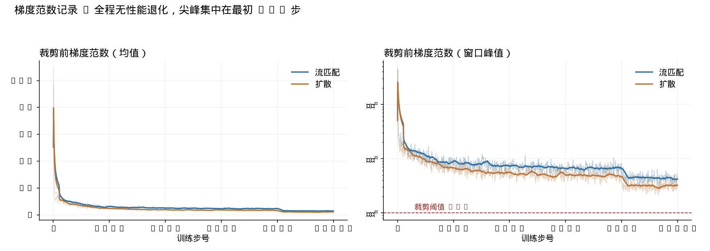
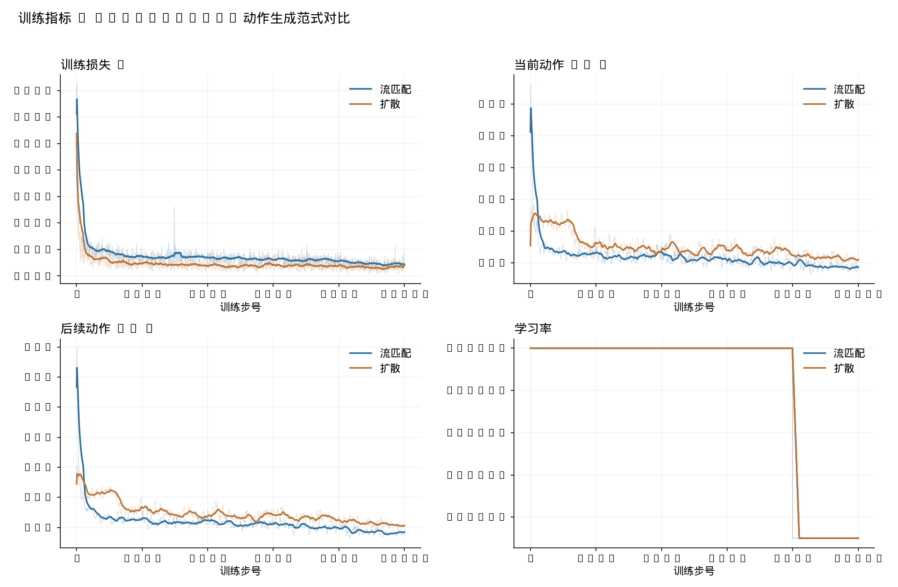
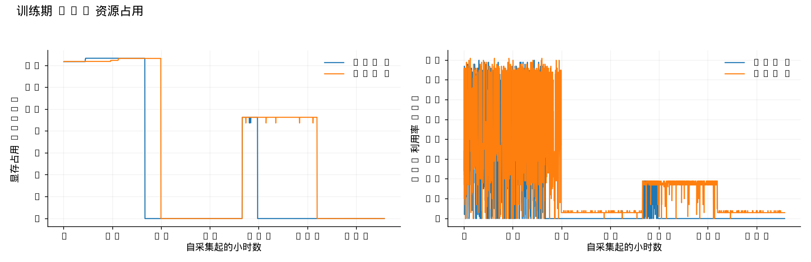

# 动作生成范式对比：L1 / 扩散 / 流匹配

## 目标

在同一个 OpenVLA-OFT 基座、同一份示教数据、同一组超参数和同一套评测脚本下，对比三种连续动作生成方式，确认差异来自范式本身而不是代码路径。

| 范式 | 训练目标 | 推理方式 | 典型推理步数 |
| --- | --- | --- | --- |
| L1 回归 | 直接回归动作 | 一次前向 | 1 |
| 扩散 | 预测噪声 | DDIM 迭代去噪 | 50 |
| 流匹配 | 预测速度场 | 欧拉积分 | 10 |

## 实现方式

三种范式共用同一套接口，切换只依靠命令行开关：

```bash
--use_l1_regression True   --use_diffusion False --use_flow_matching False
--use_l1_regression False  --use_diffusion True  --use_flow_matching False
--use_l1_regression False  --use_diffusion False --use_flow_matching True
```

流匹配沿用 π0 的 rectified flow 形式，在示教动作与高斯噪声之间定义直线路径：

```
x_t = (1 - t) * a + t * eps        u_t = eps - a
```

训练时从 `Beta(1.5, 1)` 采样时间步，用均方误差回归速度场；推理时从 `t = 1` 的纯噪声出发，以 `dt = -1 / num_steps` 做欧拉积分回到 `t = 0` 的动作。

由于流匹配和扩散都需要把"当前带噪状态"注入 LLM，两者的动作头、投影器和 LLM token 布局完全一致，只有预测目标和积分方式不同。

改动集中在五个文件，合计约 500 行，见 [flow-matching.patch](../patches/flow-matching.patch)：

| 文件 | 改动 |
| --- | --- |
| `prismatic/models/action_heads.py` | 新增 `FlowMatchingActionHead`，复用噪声预测 MLP 结构 |
| `prismatic/extern/hf/modeling_prismatic.py` | 新增 `_run_flow_matching_prediction` 欧拉积分循环与分派逻辑 |
| `vla-scripts/finetune.py` | 新增训练分支、采样器、梯度裁剪修复与梯度范数记录 |
| `experiments/robot/openvla_utils.py` | 动作头工厂支持流匹配 |
| `experiments/robot/libero/run_libero_eval.py` | 评测配置支持流匹配与推理步数 |

## 正确性验证

`tests/test_flow_matching.py` 覆盖六项数学性质，全部通过：

- 插值状态确实落在动作与噪声连成的线段上，速度目标等于噪声减动作。
- 时间采样服从 `Beta(1.5, 1)`，均值 0.597 对比理论值 0.600。
- **给定精确速度场时，欧拉积分在 1 / 2 / 5 / 10 / 20 步下都能把噪声还原成示教动作**，最大误差小于 1e-4。
- 积分方向单调逼近动作，不会走反。
- 速度头对每个动作 token 输出一个 7 维向量。
- 时间编码连续且可区分。

其中第三项是最关键的防错检查：积分方向或符号一旦写反，动作会被推向远离示教的方向，而这个测试会立刻失败。

## 过程中修复的两个真实问题

**8-bit 量化下的精度不匹配。** `prepare_model_for_kbit_training` 会把 embedding 层保留为 float32，而动作投影器输出 bfloat16，在替换动作 token 嵌入时触发 `Index put requires the source and destination dtypes match`。修复方式是在替换前对齐 dtype。这个问题同时影响扩散路径。

**采样与反向传播的显存冲突。** 原本离线 L1 指标在反向传播之前采样，此时训练图仍驻留显存，再叠加流匹配的 10 次前向，在 16GB 卡上直接 OOM。修复方式是把采样移到反向传播之后，并显式释放 loss 图。这个顺序问题在扩散路径上同样存在。

## 训练配置

三组实验共用以下配置，只有动作生成范式不同：

| 项目 | 设置 |
| --- | --- |
| 基础权重 | `openvla/openvla-7b`（各自独立副本） |
| 数据集 | `libero_spatial_no_noops` |
| 主干加载 | 8-bit 量化 |
| 参数更新 | LoRA rank 32 + 独立动作头 + 噪声投影器 |
| 输入 | 外部视角 RGB + 语言，不含机器人状态 |
| 动作输出 | 8 步动作块，每步 7 维 |
| microbatch × 累积 | 1 × 16 |
| 学习率 | `5e-4`，8,000 步后降至 `5e-5` |
| 训练步号 | 10,000 |
| 梯度裁剪 | 总范数上限 1.0，**覆盖全部可训练参数** |

### 梯度裁剪的一处修正

此前训练脚本中的裁剪只作用于 `vla.parameters()`，遗漏了独立优化的动作头和噪声投影器。流匹配的速度场预测对梯度尺度更敏感，这一遗漏的影响更大，因此改为覆盖完整的 `trainable_params`，并把**裁剪前的梯度总范数**写入 W&B。

这同时补上了此前排查 OpenVLA QLoRA 零成功率时缺失的关键证据：当时无法确认训练中期是否发生梯度异常，而现在每次更新都有范数记录。

## 实验结果

三组使用相同的 LIBERO-Spatial 设置：10 个任务、每任务 50 次、seed 7、默认初始状态，每次任务最多 220 步环境执行。

| 范式 | 成功次数 | 成功率 | 推理步数 | 训练耗时 | 最终训练损失 | 最终动作 L1 |
| --- | ---: | ---: | ---: | ---: | ---: | ---: |
| L1 回归 | **478 / 500** | **95.6%** | 1 | 38.1 h | 0.0908 | 0.0942 |
| 流匹配 | 385 / 500 | 77.0% | 10 | 43.6 h | 0.1247 | 0.1504 |
| 扩散 | 282 / 500 | 56.4% | 50 | 51.7 h | 0.1700 | 0.2567 |

流匹配的离线动作误差比扩散低 42%（0.150 对 0.257），闭环成功率相应高出 20.6 个百分点，训练耗时也少 16%，因为扩散每个记录点都要额外跑一遍 50 步 DDIM 采样来计算离线指标。

两种生成式方法都明显落后于直接回归。差距在离线指标上远小于闭环表现：三种方法在同一批 18 个观测上的首步动作 L1 分别为 0.177、0.182、0.231，几乎相当，但闭环成功率相差 39 个百分点。**这说明动作的数值误差不足以判断策略可用性**，生成式方法引入的轨迹级不一致在单步指标上看不出来。

L1 组存在一处已知的不对齐：它的 95.6% 是在修正梯度裁剪逻辑之前得到的。若要让三组严格可比，需要重跑 L1 组。

## 训练稳定性

裁剪前的梯度总范数全程记录，尖峰集中在最初 100 步，之后单调收敛，1001 个记录点内没有出现中途跳变或性能退化。

| 步数区间 | 流匹配窗口峰值 | 扩散窗口峰值 |
| --- | ---: | ---: |
| 0–100 | 433.64 | 467.21 |
| 100–1000 | 29.66 | 21.89 |
| 1000–2500 | 16.63 | 11.38 |
| 2500–5000 | 12.11 | 7.94 |
| 5000–8000 | 10.32 | 7.53 |
| 8000–10000 | 8.25 | 5.63 |



这与此前原版 OpenVLA 的 4-bit QLoRA 实验形成对照：那次在约 3,700–4,000 步处 loss 突增、动作准确率崩溃且未能恢复。修复后的裁剪覆盖了全部可训练参数，本次两组训练没有重现该现象。



## 资源占用



两组训练各占一张 16GB 卡的约 14.7 GiB，峰值出现在采样与反向传播交替的阶段。

## 逐任务表现

同一任务上，流匹配的失败模式与扩散一致，但幅度更小。

| 任务 | 流匹配 | 扩散 |
| --- | ---: | ---: |
| 盘子与ramekin之间取碗 | 86% | 68% |
| ramekin旁取碗 | 88% | 84% |
| 桌面中央取碗 | 94% | 68% |
| 饼干盒上取碗 | 90% | 86% |
| 木柜顶层抽屉取碗 | 56% | 16% |
| ramekin上取碗 | 94% | 62% |
| 饼干盒旁取碗 | 94% | 76% |
| 炉灶上取碗 | 40% | 22% |
| 盘子旁取碗 | 94% | 54% |
| 木柜上取碗 | 34% | 28% |

十个任务上流匹配全部不低于扩散。两个生成式方法都在需要从高处或狭窄位置取碗的任务上失败更多（木柜顶层抽屉、炉灶、木柜），这类任务要求更长的连续运动，生成式方法逐步积分产生的误差会累积。

## 评测过程的一个坑

两次评测在同一秒启动，`run_libero_eval.py` 用启动时刻生成日志文件名，两次运行因此写进了同一个文本日志，后完成的那次覆盖了前一次，导致流匹配的结果一度被读成扩散的结果。

rollout 视频不受影响：每次试验保存一个 MP4，文件名里带有试验编号和成功标记。两次结果不同的试验留下两个文件，结果相同的试验文件名相同、被后写入的覆盖。据此可以按文件修改时间重建归属——先写完的是较快的流匹配，后写完的是较慢的扩散——**重建结果同时复现了两个进程各自报告的总成功次数（385 与 282），因此可以确认归属正确。**

修正方法是为每次评测指定独立的 `--local_log_dir`，后续的推理步数扫描已采用这一方式。

重建脚本见 [rebuild_episodes.py](../scripts/rebuild_episodes.py)，逐次记录见 [flow_matching_episodes.csv](../results/paradigm/flow_matching_episodes.csv) 与 [diffusion_episodes.csv](../results/paradigm/diffusion_episodes.csv)。
