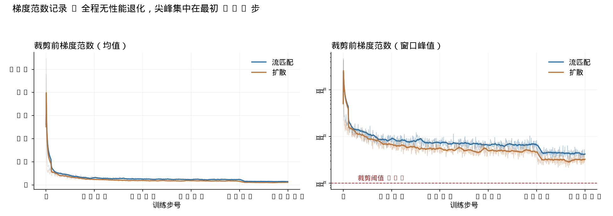
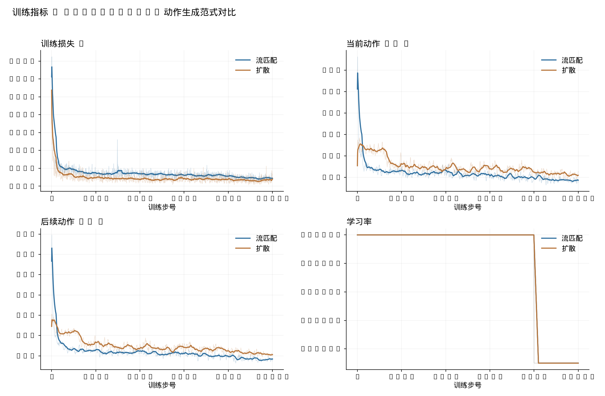
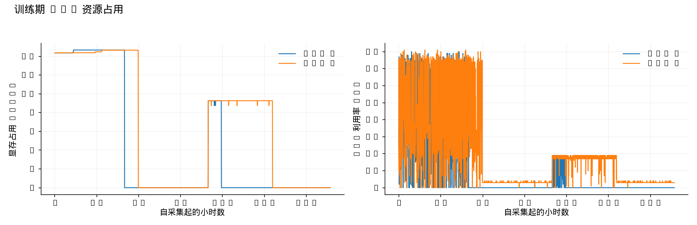
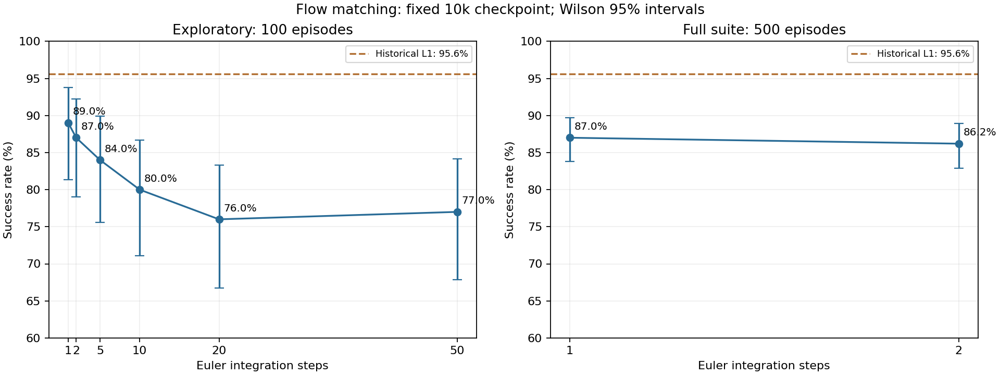

# 动作生成范式对比：L1 / 扩散 / 流匹配

## 目标

在同一个 OpenVLA-OFT 基座、同一份示教数据、主要训练超参数与评测设置一致的条件下，对比三种连续动作生成方式。L1 基线早于梯度裁剪修复，因此这不是已经排除所有混淆因素的严格范式消融。

| 范式 | 训练目标 | 推理方式 | 典型推理步数 |
| --- | --- | --- | --- |
| L1 回归 | 直接回归动作 | 一次前向 | 1 |
| 扩散 | 预测噪声 | DDIM 迭代去噪 | 50 |
| 流匹配 | 预测速度场 | 欧拉积分 | 10 |

## 实现方式

三种范式共用同一套接口，切换只依靠命令行开关：

```bash
--use_l1_regression True   --use_diffusion False --use_flow_matching False
--use_l1_regression False  --use_diffusion True  --use_flow_matching False
--use_l1_regression False  --use_diffusion False --use_flow_matching True
```

流匹配沿用 π0 的 rectified flow 形式，在示教动作与高斯噪声之间定义直线路径：

```
x_t = (1 - t) * a + t * eps        u_t = eps - a
```

训练时从 `Beta(1.5, 1)` 采样时间步，用均方误差回归速度场；推理时从 `t = 1` 的纯噪声出发，以 `dt = -1 / num_steps` 做欧拉积分回到 `t = 0` 的动作。

由于流匹配和扩散都需要把"当前带噪状态"注入 LLM，两者的动作头、投影器和 LLM token 布局完全一致，只有预测目标和积分方式不同。

改动集中在五个文件，合计约 500 行，见 [flow-matching.patch](../patches/flow-matching.patch)：

| 文件 | 改动 |
| --- | --- |
| `prismatic/models/action_heads.py` | 新增 `FlowMatchingActionHead`，复用噪声预测 MLP 结构 |
| `prismatic/extern/hf/modeling_prismatic.py` | 新增 `_run_flow_matching_prediction` 欧拉积分循环与分派逻辑 |
| `vla-scripts/finetune.py` | 新增训练分支、采样器、梯度裁剪修复与梯度范数记录 |
| `experiments/robot/openvla_utils.py` | 动作头工厂支持流匹配 |
| `experiments/robot/libero/run_libero_eval.py` | 评测配置支持流匹配与推理步数 |

## 正确性验证

`tests/test_flow_matching.py` 覆盖六项数学性质，全部通过：

- 插值状态确实落在动作与噪声连成的线段上，速度目标等于噪声减动作。
- 时间采样服从 `Beta(1.5, 1)`，均值 0.597 对比理论值 0.600。
- **给定精确速度场时，欧拉积分在 1 / 2 / 5 / 10 / 20 步下都能把噪声还原成示教动作**，最大误差小于 1e-4。
- 积分方向单调逼近动作，不会走反。
- 速度头对每个动作 token 输出一个 7 维向量。
- 时间编码连续且可区分。

其中第三项是最关键的防错检查：积分方向或符号一旦写反，动作会被推向远离示教的方向，而这个测试会立刻失败。

## 过程中修复的两个真实问题

**8-bit 量化下的精度不匹配。** `prepare_model_for_kbit_training` 会把 embedding 层保留为 float32，而动作投影器输出 bfloat16，在替换动作 token 嵌入时触发 `Index put requires the source and destination dtypes match`。修复方式是在替换前对齐 dtype。这个问题同时影响扩散路径。

**采样与反向传播的显存冲突。** 原本离线 L1 指标在反向传播之前采样，此时训练图仍驻留显存，再叠加流匹配的 10 次前向，在 16GB 卡上直接 OOM。修复方式是把采样移到反向传播之后，并显式释放 loss 图。这个顺序问题在扩散路径上同样存在。

## 训练配置

三组实验共用以下配置，只有动作生成范式不同：

| 项目 | 设置 |
| --- | --- |
| 基础权重 | `openvla/openvla-7b`（各自独立副本） |
| 数据集 | `libero_spatial_no_noops` |
| 主干加载 | 8-bit 量化 |
| 参数更新 | LoRA rank 32 + 独立动作头 + 噪声投影器 |
| 输入 | 外部视角 RGB + 语言，不含机器人状态 |
| 动作输出 | 8 步动作块，每步 7 维 |
| microbatch × 累积 | 1 × 16 |
| 学习率 | `5e-4`，8,000 步后降至 `5e-5` |
| 训练步号 | 10,000 |
| 梯度裁剪 | 总范数上限 1.0，**覆盖全部可训练参数** |

### 梯度裁剪的一处修正

此前训练脚本中的裁剪只作用于 `vla.parameters()`，遗漏了独立优化的动作头和噪声投影器。流匹配的速度场预测对梯度尺度更敏感，这一遗漏的影响更大，因此改为覆盖完整的 `trainable_params`，并把**裁剪前的梯度总范数**写入 W&B。

这同时补上了此前排查 OpenVLA QLoRA 零成功率时缺失的关键证据：当时无法确认训练中期是否发生梯度异常，而现在每次更新都有范数记录。

## 实验结果

三组使用相同的 LIBERO-Spatial 设置：10 个任务、每任务 50 次、seed 7、默认初始状态，每次任务最多 220 步环境执行。

| 范式 | 成功次数 | 成功率 | 推理步数 | 训练耗时 | 最终训练损失 | 最终动作 L1 |
| --- | ---: | ---: | ---: | ---: | ---: | ---: |
| L1 回归 | **478 / 500** | **95.6%** | 1 | 38.1 h | 0.0908 | 0.0942 |
| 流匹配 | 385 / 500 | 77.0% | 10 | 43.6 h | 0.1247 | 0.1504 |
| 扩散 | 282 / 500 | 56.4% | 50 | 51.7 h | 0.1700 | 0.2567 |

流匹配的离线动作误差比扩散低 42%（0.150 对 0.257），闭环成功率相应高出 20.6 个百分点，训练耗时也少 16%，因为扩散每个记录点都要额外跑一遍 50 步 DDIM 采样来计算离线指标。

两种生成式方法都明显落后于直接回归。差距在离线指标上远小于闭环表现：三种方法在同一批 18 个观测上的首步动作 L1 分别为 0.177、0.182、0.231，几乎相当，但闭环成功率相差 39 个百分点。**这说明动作的数值误差不足以判断策略可用性**，生成式方法引入的轨迹级不一致在单步指标上看不出来。

L1 组存在一处已知的不对齐：它的 95.6% 是在修正梯度裁剪逻辑之前得到的。若要让三组严格可比，需要重跑 L1 组。

## 训练稳定性

裁剪前的梯度总范数全程记录，尖峰集中在最初 100 步，之后单调收敛，1001 个记录点内没有出现中途跳变或性能退化。

| 步数区间 | 流匹配窗口峰值 | 扩散窗口峰值 |
| --- | ---: | ---: |
| 0–100 | 433.64 | 467.21 |
| 100–1000 | 29.66 | 21.89 |
| 1000–2500 | 16.63 | 11.38 |
| 2500–5000 | 12.11 | 7.94 |
| 5000–8000 | 10.32 | 7.53 |
| 8000–10000 | 8.25 | 5.63 |



这与此前原版 OpenVLA 的 4-bit QLoRA 实验形成对照：那次在约 3,700–4,000 步处 loss 突增、动作准确率崩溃且未能恢复。修复后的裁剪覆盖了全部可训练参数，本次两组训练没有重现该现象。



## 资源占用



两组训练各占一张 16GB 卡的约 14.7 GiB，峰值出现在采样与反向传播交替的阶段。

## 逐任务表现

同一任务上，流匹配的失败模式与扩散一致，但幅度更小。

| 任务 | 流匹配 | 扩散 |
| --- | ---: | ---: |
| 盘子与ramekin之间取碗 | 86% | 68% |
| ramekin旁取碗 | 88% | 84% |
| 桌面中央取碗 | 94% | 68% |
| 饼干盒上取碗 | 90% | 86% |
| 木柜顶层抽屉取碗 | 56% | 16% |
| ramekin上取碗 | 94% | 62% |
| 饼干盒旁取碗 | 94% | 76% |
| 炉灶上取碗 | 40% | 22% |
| 盘子旁取碗 | 94% | 54% |
| 木柜上取碗 | 34% | 28% |

十个任务上流匹配全部不低于扩散。两个生成式方法在木柜顶层抽屉、炉灶、木柜任务上失败更多。这是任务分布上的观察；仅凭成功率不能确认失败由长动作序列、积分误差还是观测／控制分布偏移引起。

## 推理步数扫描

### “步数”具体改变什么

固定同一份训练 10,000 步的权重、同一张观测图像和指令，从高斯噪声动作块 `x_1` 开始：

```text
x_t = (1-t) a + t eps
v_target = eps - a
x_(t-1/N) = x_t - (1/N) v_theta(x_t, t, observation)
```

| 推理积分步数 N | 速度场查询时间 | 内部过程 |
| --- | --- | --- |
| 1 | 1 | 从噪声一次大步更新到动作 |
| 2 | 1、0.5 | 先更新一半，再在新状态上重估速度 |
| 10 | 1、0.9、…、0.1 | 十次小步更新 |

这不是“多看几张新相机图像”，也不是“让机械臂多执行几步”。每次策略查询始终输出 **8 步 × 7 维** 的动作块，评测中执行 8 步后再取新观测。视觉 patch 在本次查询内复用，积分循环每次重新运行语言主干和速度头，所以 N 增大主要增加内部计算量。真实端到端时延还包括图像编码、渲染、控制和数据搬运，不能直接等同于 N 倍。

如果速度场精确且沿目标直线路径为常量，1 步就能还原动作；对于同一个足够光滑的近似速度场，缩小欧拉步长通常改善的是数值 ODE 解的近似，并不保证机器人任务成功率提高。网络的速度预测偏差、离分布状态和闭环控制都会影响结果。更多步数可能更准确地积分了一个本身有偏的速度场。

训练 `Beta(1.5,1)` 时间采样使低 t 区域样本更少，但“低 t 误差累积导致本次降分”**仍是假设**。此前逐 t 误差诊断因形状与显存问题没有得到可信完整结果，本发布不把它写成机制结论。

### 探索性扫描：每档 100 次

固定同一份 10k 权重，每任务 10 次、seed 7。此表用于选取完整复评档位，不与 500 次结果混合：

| 推理步数 | 成功次数 | 成功率 |
| ---: | ---: | ---: |
| 1 | 89 / 100 | 89.0% |
| 2 | 87 / 100 | 87.0% |
| 5 | 84 / 100 | 84.0% |
| 10 | 80 / 100 | 80.0% |
| 20 | 76 / 100 | 76.0% |
| 50 | 77 / 100 | 77.0% |

### 2026-11-03 完整复评：每档 500 次

| 推理步数 | 成功次数 | 成功率 | Wilson 95% 区间 |
| ---: | ---: | ---: | ---: |
| **1** | **435 / 500** | **87.0%** | 83.8%–89.7% |
| 2 | 431 / 500 | 86.2% | 82.9%–88.9% |
| 10，历史完整评测 | 385 / 500 | 77.0% | 见原始范式结果 |



1 步和 2 步于北京时间 **2026-11-03 15:08**、**13:06** 完成，使用 `paradigm_fm--10000_chkpt`，不是新的训练。两组同为 `libero_spatial`、每任务 50 次、seed 7、LIBERO 默认初始状态、单相机、无 proprio、8-bit 加载、动作块执行长度 8。

把任务描述与每任务试验序号配对：422 对共同成功，56 对共同失败，13 对仅 1 步成功，9 对仅 2 步成功。精确双侧 McNemar 检验 **p=0.523**；0.8 个百分点的差距不足以证明 1 步稳定优于 2 步。相同初始状态不代表两次采样的动作噪声逐项相同；检验也没有替代多训练种子／多评测种子实验。

相比历史 10 步完整评测，1 步的观测成功率增加 10 个百分点，但新档位由探索性扫描选出，历史 10 步不是这次同步重跑的对照，且其逐次记录曾经重建，因此不能把差值直接推广到其他 checkpoint、套件或训练种子。离线 18 个训练集观测的 L1 在各步数约 0.17–0.21，只能作为局部诊断，不能证明泛化或解释闭环差异。

逐任务比较与全部逐次结果分别在 [steps_sweep_tasks.csv](../results/paradigm/steps_sweep_tasks.csv)、[steps_sweep_episodes.csv](../results/paradigm/steps_sweep_episodes.csv)。[汇总 JSON](../results/paradigm/steps_sweep_verified.json) 包含区间、配对计数及每份证据日志的 SHA-256；[配置](../configs/flow_matching_sweep.json) 区分探索性和完整评测。两组新的完整评测原始日志独立保存，没有沿用早期日志覆盖后的重建方式。

| 任务（均为取黑碗后放入盘子） | 1 步成功 / 50 | 2 步成功 / 50 |
| --- | ---: | ---: |
| 盘子与 ramekin 之间 | 49 | 48 |
| ramekin 旁 | 50 | 48 |
| 桌面中央 | 50 | 50 |
| 饼干盒上 | 49 | 48 |
| 木柜顶层抽屉内 | 48 | 47 |
| ramekin 上 | 48 | 49 |
| 饼干盒旁 | 50 | 50 |
| 炉灶上 | 21 | 23 |
| 盘子旁 | 50 | 49 |
| 木柜上 | 20 | 19 |

1 步评测的 65 次失败中，炉灶和木柜两项占 59 次；降低积分步数没有消除这些任务瓶颈。这定位了后续需要看 rollout 的任务，但没有证明具体物理失败原因。

### 从归档重新算结果

```bash
python3 scripts/export_step_sweep.py --check
python3 scripts/verify_results.py
python3 tests/test_step_sweep.py
python3 scripts/plot_verified_sweep.py
```

第一项从 8 份独立日志重新解析 **1,600 次**试验，核对每个任务的覆盖、最终计数、汇总表、逐次表及原始日志哈希。去掉 `--check` 可重新生成表；不需要 GPU、模型权重或服务器路径。绘图额外需要 matplotlib。

### 从模型重跑

先按 [复现步骤](复现.md) 安装环境。必须在干净的固定上游版本上选择完整范式补丁，**不要在 `oft-16gb.patch` 之上再叠加 `flow-matching.patch`**，两者存在重叠：

```bash
WITH_FLOW_MATCHING=1 VLA_WORKSPACE="$HOME/vla-fm-work" \
  bash scripts/prepare_sources.sh

VLA_WORKSPACE="$HOME/vla-fm-work" \
MODEL_PATH="$HOME/vla-models/openvla-7b-fm" \
DATA_ROOT="$HOME/vla-data" GPU=0 PARADIGM=fm \
  bash scripts/train_paradigm.sh

VLA_WORKSPACE="$HOME/vla-fm-work" \
CHECKPOINT="$HOME/vla-fm-work/paradigm_runs/your-paradigm_fm--10000_chkpt" \
GPU=0 STEPS="1 2" TRIALS=50 LOG_ROOT="$HOME/vla-fm-evals" \
  bash scripts/eval_step_sweep.sh
```

基础权重和示教数据仍按上游条款自行获取；本项目训练的 10k 权重目前没有公开下载，因此外部复现需要训练，不能声称 clone 后立即重现相同数字。完整 checkpoint 必须同时含主干、adapter、动作头、噪声投影器和归一化统计。基础模型目录使用独立副本，因为上游会同步配置与模型源码。

`STEPS="1 2 5 10 20 50" TRIALS=10` 对应探索性扫描。`DRY_RUN=1` 只打印已校验路径后的命令、不启动评测。脚本串行运行，每个档位使用独立日志目录，避免日志覆盖与并行显存竞争。本次任务曾因 OOM 重启，归档只选择有完整 500 次计数的最终日志；中途失败日志不参与统计。评测结尾若看到 EGL 清理异常，应与正式计数／逐次异常分开核对，不把渲染器退出信息当成新增任务失败。

数学形式参考 π0 原论文（arXiv:2410.24164）与本仓库固定版本上的实现；本文结论仅来自本项目日志，不代表官方 π0 或官方 OFT 成绩。

## 评测过程的一个坑

两次评测在同一秒启动，`run_libero_eval.py` 用启动时刻生成日志文件名，两次运行因此写进了同一个文本日志，后完成的那次覆盖了前一次，导致流匹配的结果一度被读成扩散的结果。

rollout 视频不受影响：每次试验保存一个 MP4，文件名里带有试验编号和成功标记。两次结果不同的试验留下两个文件，结果相同的试验文件名相同、被后写入的覆盖。据此可以按文件修改时间重建归属——先写完的是较快的流匹配，后写完的是较慢的扩散——**重建结果同时复现了两个进程各自报告的总成功次数（385 与 282），因此可以确认归属正确。**

修正方法是为每次评测指定独立的 `--local_log_dir`，后续的推理步数扫描已采用这一方式。

重建脚本见 [rebuild_episodes.py](../scripts/rebuild_episodes.py)，逐次记录见 [flow_matching_episodes.csv](../results/paradigm/flow_matching_episodes.csv) 与 [diffusion_episodes.csv](../results/paradigm/diffusion_episodes.csv)。
